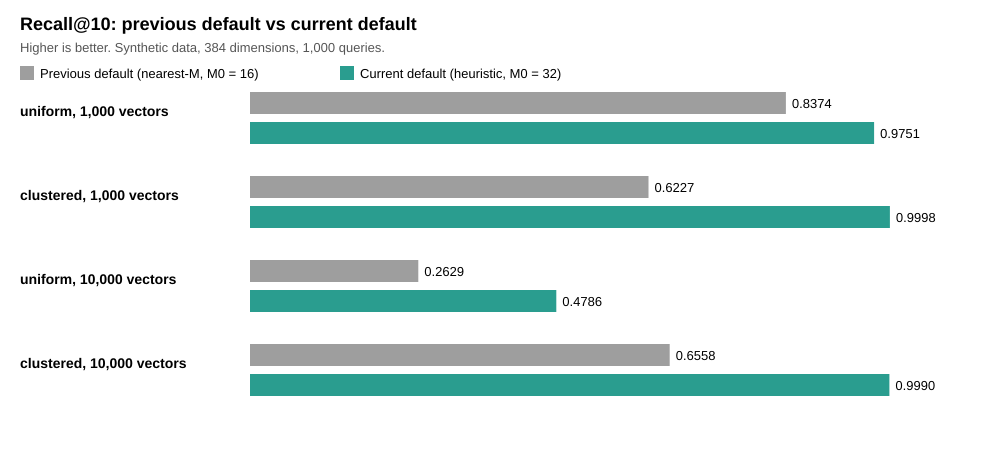

# VectOrEngine: The Rust Engine Behind VectOrEdit's Linter and Knowledge Search

[](LICENSE)
[](package.json)

[](#security-facts-checked-on-2026-11-05)[](https://github.com/1abcdefggs/vect-or-engine/actions/workflows/rust.yml)
[](https://github.com/1abcdefggs/vect-or-engine/security/code-scanning)


VectOrEngine (repository `vect-or-engine`, package `@1abcdefggs/vect-or-engine`) is a native library written in Rust. It is not an editor. It was built for [VectOrEdit](https://github.com/1abcdefggs/vect-or-edit), our Electron desktop editor, and runs inside it through N-API.

- **Repository**: [https://github.com/1abcdefggs/vect-or-engine](https://github.com/1abcdefggs/vect-or-engine)
- **Author / Copyright**: Copyright (c) 2026 [@1abcdefggs](https://github.com/1abcdefggs)

---

## What VectOrEngine Does

### Checks Documents Against Guideline Rules as You Type

A guideline profile (JSON) lists keywords, patterns and thresholds. `loadProfile` reads it and `validateSync` checks a text against it, returning markers with line, severity and message. Literal rules use an Aho-Corasick automaton (the `aho-corasick` crate); regular-expression rules are also supported. The match mode is `literal` (default), `regex` or `both`.

### Finds Related Knowledge Entries by Vector Similarity (HNSW)

A knowledge base is a list of entries with 384-dimensional vectors (the dimension the project's embedding model uses). The engine keeps vectors as exact `f32` in one contiguous matrix that the exact scan and the HNSW graph share (the SQLite cache stores `f16`), builds an HNSW graph (heuristic neighbour selection; M = 16, M0 = 32, efConstruction = 200, efSearch = 64) and returns the nearest entries by cosine similarity. Search accuracy is measured in [How accurate the search is](#how-accurate-the-search-is-recall).

How the core stores and scans vectors:

- Knowledge files are read once with `fs::read` and parsed (no memory mapping, no `unsafe`); files over 1 GiB are rejected
- The dot product is safe Rust with 16 independent accumulators over fixed-size chunks and one fixed summation order, used by the exact scan and the index alike; the compiler vectorises it at the build target's baseline (SSE2 unless `target-cpu` is raised)
- Without an index, or for mid-size data, a parallel linear scan with `rayon` is used
- The Rust API also has a `SearchQuery` bundle (top-k, minimum similarity threshold, slot routing); the N-API `search` takes only the vector and `topK`

### Runs Offline Inside the App, with No Server and No Network

The engine is loaded into the host process as a `.node` addon built with `napi-rs`, so calls are direct function calls with no IPC serialization. Documents and knowledge never leave the machine. Heavy calls run on a worker pool (`spawn_blocking`), so they do not block the JavaScript thread. A SQLite cache (`saveKbCache`, `loadKbCache`) skips JSON parsing and quantization on the next start.

---

## How VectOrEdit Uses This Engine

### Screen Demo: VectOrEdit v0.3.56

<div align="center">
  
  <br />
  <sub>VectOrEdit v0.3.56: the linter markers and the <kbd>Alt</kbd>+<kbd>S</kbd> knowledge search run on this engine · more in the <a href="https://github.com/1abcdefggs/vect-or-edit">VectOrEdit repository</a></sub>
</div>

### Which Edit Feature Calls Which Engine Function

| VectOrEdit feature | Engine functions |
| :--- | :--- |
| Guideline linter (markers while typing) | `loadProfile`, `validateSync` |
| Knowledge search (<kbd>Alt</kbd>+<kbd>S</kbd>) | `loadKnowledgeBase`, `buildIndex`, `search` |
| Build shown in About (planned) | `buildInfo` |

The query vectors come from VectOrEdit's own embedding model; the engine does not create embeddings.

### How Edit Loads the Engine (N-API in the Main Process)

VectOrEdit depends on a sibling checkout (`"@1abcdefggs/vect-or-engine": "file:../vect-or-engine"`), loads the built `.node` in the Electron main process, and ships it with its installer.

---

## Search Accuracy at a Glance: Recall@10 0.998 on the Project's Own Data



- On the project's own embeddings (3,840 vectors), the search finds 99.8% of the true 10 nearest entries (recall@10 0.998)
- On synthetic data, the current default raised recall in every case shown above; random (uniform) vectors at 10,000 entries remain the hard case (0.48)
- Details: [How Accurate the Search Is](#how-accurate-the-search-is-recall) below, and the full procedure and reports in [verification/recall](verification/recall/README.md)

---

## Install the Engine in an Electron or Node.js App

### Supported Platforms: .node for Windows x64, Core and CLI for Windows and Linux

[](#supported-platforms-node-for-windows-x64-core-and-cli-for-windows-and-linux)
[](https://nodejs.org/)

The published package contains the `.node` addon for Windows x64 only. The core engine and the CLI also build and run on Linux (checked by CI on ubuntu-latest). The package requires Node.js 24 or later.

### Install from GitHub Packages (.npmrc and Token)

[](https://github.com/1abcdefggs/vect-or-engine/packages)

The package is published to GitHub Packages (latest published: 0.3.6). npm needs the scope's registry and a token with `read:packages`, for example in `.npmrc`:

```ini
@1abcdefggs:registry=https://npm.pkg.github.com
//npm.pkg.github.com/:_authToken=${NODE_AUTH_TOKEN}
```

```bash
npm install @1abcdefggs/vect-or-engine
```

### Use a Local Checkout Instead (How VectOrEdit Does It)

```bash
# Link a sibling checkout
npm link ../vect-or-engine
```

Or depend on it with `"@1abcdefggs/vect-or-engine": "file:../vect-or-engine"` and build the `.node` there first (see [Build and test from source](#build-and-test-from-source)).

---

## Call the Engine from JavaScript / TypeScript

### Function List: 11 Functions and Their Arguments

All state (profile, knowledge base, index) lives in one engine instance per process.

| Function | Returns | Purpose |
| :--- | :--- | :--- |
| `ping(name: string)` | `string` | Check that the addon loads |
| `buildInfo()` | `{ version, gitHash, gitDirty, builtAtUnix }` | Identify the loaded build |
| `loadProfile(path: string, matchMode?: 'literal' \| 'regex' \| 'both')` | `Promise<void>` | Load guideline rules; the knowledge base is kept |
| `validateSync(text: string)` | `{ isValid, markers[] }` | Check a text against the profile (blocking) |
| `validate(text: string)` | `Promise<{ isValid, markers[] }>` | Same check on the worker pool |
| `loadKnowledgeBase(path: string)` | `Promise<number>` (entries) | Read a knowledge JSON file |
| `saveKbCache(path: string)` | `Promise<void>` | Write the loaded vectors to SQLite |
| `loadKbCache(path: string)` | `Promise<number>` (entries) | Read vectors from the SQLite cache |
| `buildIndex()` | `Promise<number>` (indexed) | Build the HNSW graph |
| `search(query: Float32Array, topK: number, ef?: number)` | `Promise<{ idx, score, id?, metadata }[]>` | Nearest entries by cosine similarity (vectors and query are normalised to unit length); the query length must match the stored dimension; `ef` is the optional HNSW width, default `max(64, 2 * topK)` |
| `kbInfo()` | `Promise<{ count, dim, hnswReady, maxNormDeviation, rescaledCount }>` | State of the knowledge base; `hnswReady` stays false under 10,000 items, which are searched exactly and need no index |

Paths must not be empty or contain NUL characters.

### Example: Lint a Document

```typescript
import { loadProfile, validateSync } from '@1abcdefggs/vect-or-engine';

// matchMode: 'literal' (default), 'regex' or 'both'.
// Call again with the same profile to change it; the knowledge base is kept
await loadProfile('./guidelines/medical_rules.json', 'literal');

const lintResult = validateSync('Target document text from Monaco Editor...');
if (!lintResult.isValid) {
  console.warn('Linter markers:', lintResult.markers);
}
```

### Example: Load a Knowledge Base and Search It

```typescript
import { loadKnowledgeBase, buildIndex, search } from '@1abcdefggs/vect-or-engine';

await loadKnowledgeBase('./knowledge_base.json');
await buildIndex();

// 384-dimensional query vector from your embedding model
const queryVector = new Float32Array([0.12, 0.45, -0.33 /* ... 384 dims */]);
const results = await search(queryVector, 5); // top 5 nearest entries
console.log(results);
```

### Example: Reuse the SQLite Cache on the Next Start

```typescript
import { loadKbCache, loadKnowledgeBase, saveKbCache, buildIndex } from '@1abcdefggs/vect-or-engine';

const cachePath = './cache/knowledge.sqlite';
try {
  // Warm start: read vectors from SQLite (the speed-up is not measured)
  const count = await loadKbCache(cachePath);
  console.log(`Loaded ${count} vectors from cache.`);
} catch {
  // Cold start: parse JSON and write the cache (the cache stores f16)
  await loadKnowledgeBase('./knowledge_base.json');
  await saveKbCache(cachePath);
}
await buildIndex();
```

### Check Which Build Is Loaded (buildInfo)

```typescript
import { buildInfo } from '@1abcdefggs/vect-or-engine';
console.log(buildInfo()); // { version, gitHash, gitDirty, builtAtUnix }
```

The values are fixed at build time. The version number alone cannot tell two builds apart; compare `gitHash` with HEAD (`npm run check:engine` does this).

---

## How Accurate the Search Is (Recall)

### What Recall@10 Means

Recall@10 is the fraction of the true 10 nearest vectors that the index returns. Higher is better. Query speed is not stated here, because it varies between runs on the same machine.

### Results on Synthetic Data: 1,000 and 10,000 Vectors

Random (uniform) or clustered vectors, 384 dimensions, 1,000 queries. These are not sentence embeddings:

| Data | Previous default | Current default |
| :--- | ---: | ---: |
| uniform, 1,000 vectors | 0.8374 | **0.9751** |
| clustered, 1,000 vectors | 0.6227 | **0.9998** |
| uniform, 10,000 vectors | 0.2629 | **0.4786** |
| clustered, 10,000 vectors | 0.6558 | **0.9990** |

The current default uses heuristic neighbour selection, with M = 16 and M0 = 32 links on layer 0. Uniform vectors point in random directions, so they are the hardest case for graph search; recall stays at about 0.48 at 10,000 vectors. Dimension 768 was also measured: uniform 0.385, clustered 0.999.

### Results on the Project's Own Embeddings: 0.998

The project's sentence embeddings (multilingual-e5-small, 384 dimensions; 7 dictionaries, 3,840 vectors in one index; every stored vector as a query) gave recall@10 0.998 with the current default (2026-11-05). This data behaves like the clustered case, not the uniform one. That script is not in this repository yet.

### How to Reproduce the Measurement

The full procedure, reports and reproduction script are in [verification/recall](verification/recall/README.md).

---

## MCP Server (Experimental, Not in a Release Yet)

> ⚠️ `mcp/server.mjs` is experimental reference code. It is not used by VectOrEdit and has not been tested end to end.

### Start the Server

```bash
npm run start-mcp
```

It listens on `127.0.0.1:4000` (change with `PORT`) and takes JSON-RPC requests at `POST /mcp`. Methods: `ping`, `load`, `build`, `search`, `validate`, `kb_info`.

### Request Gate: Host Check, Optional Token, Allowed Folder

Every request passes a gate before it runs (on `main` since PR #25; not yet in a published release, planned for 0.4.0):

| Check | Default | Setting |
| :--- | :--- | :--- |
| `Host` and `Origin` headers must be `127.0.0.1` or `localhost` (blocks DNS rebinding and cross-site requests) | On; HTTP 403 otherwise | None |
| `Authorization: Bearer <token>` | Off; the server logs a warning at startup | Set `MCP_AUTH_TOKEN`; HTTP 401 without the right token |
| `load` paths must resolve (links included) under an allowed folder | On; the folder is this repository | Set `KB_ALLOWED_ROOT`; the server stops at startup if it does not exist |

### Error Codes Returned to the Client

Errors follow JSON-RPC 2.0: -32700 parse error, -32600 invalid request, -32601 unknown method, -32602 invalid params (with the reason), -32603 internal error (details only in the server log).

---

## Build and Test from Source

### Requirements: Rust and Node.js 24

[](https://www.rust-lang.org/)
[](https://napi.rs/)

- [Rust](https://www.rust-lang.org/) (2021 edition, `cargo` v1.75+)
- [Node.js](https://nodejs.org/) (v24+)

### Build the .node Addon

```bash
npm install
npm run build
```

The N-API bindings sit behind the `napi` Cargo feature. `npm run build` passes `--features napi` and produces the `.node` addon. A plain `cargo build` compiles the core engine and the CLI without N-API:

| Target | Command | Includes N-API |
| :--- | :--- | :--- |
| Node.js addon (`.node`) | `npm run build` (passes `--features napi`) | Yes |
| CLI (`vect_or_engine_cli`) and plain `cargo build` | `cargo build` | No |

The `napi_*` symbols exist only inside a running Node.js process, so keeping them out of the default build lets the CLI link on Linux (checked by the `Rust` CI workflow on ubuntu-latest).

### Build and Run the CLI

The headless CLI is for non-Node.js pipelines and terminal testing.

```bash
cargo run --bin vect_or_engine_cli
```

The CLI reads one JSON-RPC request per line on stdin (`{"method":"ping","id":"1"}`) and writes one response per line on stdout. It runs on Windows and Linux (Linux checked under WSL Ubuntu on 2026-11-03). File paths must be relative; absolute paths and `..` are rejected.

- Requests run concurrently, so responses can arrive out of order; match them by `id`
- The process exits as soon as stdin closes, and responses still in progress are dropped; keep stdin open until every response has arrived

### Run the Tests

```bash
# Rust unit and integration tests (core engine)
cargo test

# Also the N-API binding unit tests (checked on Windows)
cargo test --features napi

# Node.js N-API integration tests
npm test

# Match modes (literal / regex / both) against the built addon
node test/test-match-modes.js

# Build-check verdicts (needs the full git history)
node --test test/test-engine-build-check.mjs

# Check that the built .node matches HEAD (exit 1 when stale or unknown)
npm run check:engine
```

### Repository Layout

The core engine (`src/*.rs` except `napi_bindings.rs`) has no N-API dependency; the `.node` addon and the CLI both build on it.

```
vect-or-engine/
├── Cargo.toml          # Rust crate configuration, `napi` feature & optimization profiles
├── Cargo.lock          # Deterministic Rust dependency lockfile
├── build.rs            # Embeds git hash, dirty flag and build time for buildInfo()
├── index.js            # Cross-platform native addon loader
├── index.d.ts          # TypeScript type declarations
├── package.json        # npm package configuration & NAPI metadata (@1abcdefggs/vect-or-engine)
├── LICENSE             # MIT License
├── README.md           # Documentation
├── mcp/
│   └── server.mjs      # Model Context Protocol (MCP) JSON-RPC HTTP server
├── scripts/
│   └── engine-build-check.mjs # Checks that a built .node matches HEAD (npm run check:engine)
├── examples/
│   └── bench.rs        # HNSW recall and latency benchmark
├── verification/
│   └── recall/         # Recall procedure, reports and reproduction scripts
├── test/
│   ├── test-napi.js    # Node.js N-API integration tests
│   ├── test-match-modes.js # Match modes literal / regex / both (needs a built .node)
│   ├── test-engine-build-check.mjs # Build-check verdicts on the git history
│   └── test-kb.json    # Minimal test dataset
└── src/
    ├── lib.rs          # Crate root: core engine modules & public re-exports (no N-API)
    ├── napi_bindings.rs # N-API bindings & Node.js native interface (only with --features napi)
    ├── main.rs         # Headless CLI binary (vect_or_engine_cli), core engine only
    ├── hnsw_index.rs   # HNSW graph indexing & search implementation
    ├── knowledge_store.rs # Knowledge store (shared f32 matrix) and SQLite cache
    ├── validator.rs    # Real-time static linter & rule evaluator
    ├── translator.rs   # Term mapping & colloquial pattern matching
    ├── profile.rs      # Schema-driven profile deserializer
    └── engine_error.rs # Typed engine error definitions
```

---

## Security: Facts Checked on 2026-11-05

### Dependencies and Alerts

No runtime npm dependencies; `npm audit` reports 0 vulnerabilities. GitHub Dependabot, code scanning (CodeQL) and secret scanning have 0 open alerts.

### SQL and `unsafe` Code

- **SQL**: the SQLite cache (`knowledge_store.rs`) uses prepared statements with bound parameters (`rusqlite::params!`); no SQL is built from strings
- **`unsafe` code**: none in the core modules (each has `#![forbid(unsafe_code)]`, since 0.3.8). Memory safety is checked at compile time

### MCP Server Exposure

The experimental MCP server runs only when started with `npm run start-mcp` and listens on `127.0.0.1` only. On `main` it checks `Host` / `Origin`, limits `load` to `KB_ALLOWED_ROOT` and supports an opt-in bearer token (warning at startup when unset); this gate is not yet in a published release (planned for 0.4.0), and 0.3.6 and earlier have no gate. Since 0.3.6 the server does not return raw error details to the client (CodeQL alert #1); internal errors answer `Internal error` and are logged on the server.

### Earlier Audit (Not Quoted)

An earlier audit (2026-09-14) is kept as an internal record and is not published here. It did not cover the `unsafe` blocks or the missing MCP gate, so its rating is not quoted.

---

## License: MIT

This project is licensed under the [MIT License](LICENSE).  
Copyright (c) 2026 [@1abcdefggs](https://github.com/1abcdefggs).
