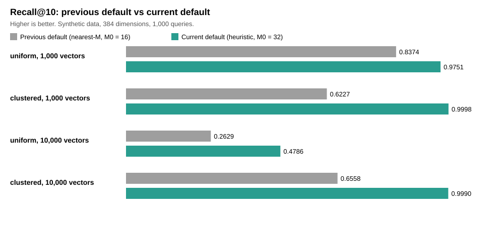
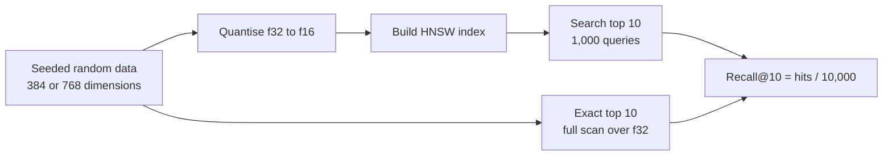
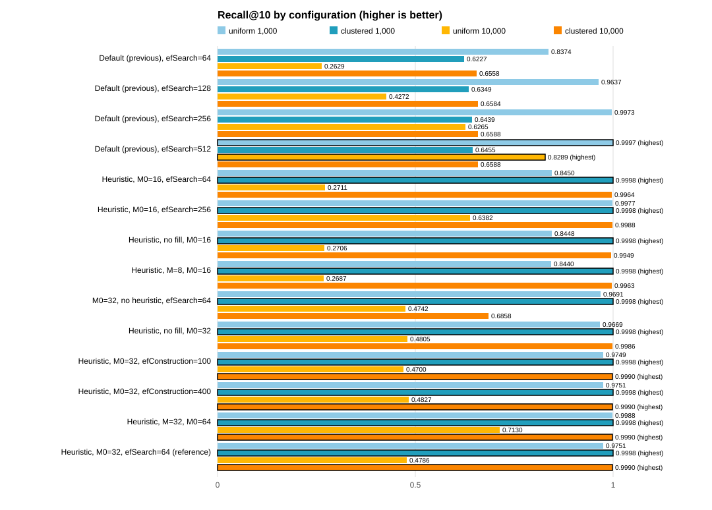

# Recall verification for the HNSW index

This folder contains the procedure, the reproduction script and the recorded results for the
recall@10 measurements of the HNSW index in `src/hnsw_index.rs`. It explains which configuration
is used as the reference, why repeated runs give the same recall, and what the measurements do
and do not show.

## At a glance



- **Result**: the current default raises recall@10 on clustered data from 0.66 to 0.999 at 10,000 vectors, and on uniform data from 0.26 to 0.48.
- **Reproducible**: the same configuration gives identical recall in every repeated run (four runs at 384 dimensions, two at 768).
- **Limit**: the data are synthetic. Query speed varies too much between runs to report as a number.

**Contents**: [0. Findings](#0-findings-summary) · [3. Method](#3-method) · [5. Results](#5-results) · [6. How to reproduce](#6-how-to-reproduce) · [7. Limitations](#7-limitations)

## 0. Findings (summary)

This is the summary of the recall investigation. The details are in the sections below.

### 0.1 Question

The HNSW index in the engine has low recall on the synthetic benchmark with its previous default
settings (recall@10 = 0.26 for uniform vectors at 10,000, and 0.66 for clustered vectors). The
question was whether the cause is the search width, the graph parameters or the neighbour
selection, and which configuration should be the default.

### 0.2 Main findings

1. **Neighbour selection was the main cause of the low clustered recall.** Changing the selection
   from "nearest M" to the diversity heuristic raised clustered recall at 10,000 vectors from 0.66
   to 0.996 (efSearch = 64). Widening the search alone did not help clustered data: with efSearch =
   512 it stayed at 0.66.
2. **Uniform recall depends mainly on the search width and the connection count.** At 10,000 vectors,
   uniform recall was 0.26 with the previous default, 0.83 with efSearch = 512, 0.48 with the
   reference configuration, and 0.71 with M = 32 (M0 = 64).
3. **Layer-0 connections (M0 = 32) help more than the other build settings.** Going from M0 = 16 to
   M0 = 32 raised uniform recall at 10,000 from 0.27 to 0.48, with the heuristic.
4. **Settings with little or no effect on recall:**
   - efConstruction 100, 200 and 400: recall on uniform 10,000 ranged from 0.470 to 0.483 (a
     difference of at most 0.013). It changes the build time.
   - Filling the free slots with rejected candidates: the difference was at most 0.002.
   - M = 8: no gain compared with M = 16.
5. **The cost of the best settings is high.** M = 32 gives the best uniform recall (0.71), but the
   build of 10,000 uniform vectors took about 200 seconds, against about 40 seconds for the reference.
   The graph memory was not measured, so the memory cost is not known.
6. **Dimension 768 lowers uniform recall and keeps clustered recall.** At 768 the reference
   configuration gave 0.385 for uniform 10,000 (against 0.479 at 384), and 0.999 for clustered
   10,000. The build took about twice as long.
7. **Reproducibility.** The recall values are identical across repeated runs of the same code and
   configuration (four runs of the reference configuration at 384, and two at 768). Latency is not
   reproducible: the p50 of the same configuration varied by a factor of up to about 5 between runs.

### 0.3 Reference configuration (not yet the default)

Heuristic neighbour selection with filling, M = 16, M0 = 32, efConstruction = 200, efSearch = 64.
It gives clustered recall of 0.999 and uniform recall of 0.48 at 10,000 vectors (384 dimensions).
This configuration is now the default in the code (`HnswParams::default()`). The change is not yet
committed.

### 0.4 What was not established

- **Latency**: the speeds in the reports vary too much between runs to be stated as numbers. The
  README claim of sub-millisecond search is not verified by these results.
- **Real embeddings**: all data are synthetic (random or clustered). Recall on real sentence
  embeddings is not measured.
- **Other dimensions**: only 384 and 768 were tested.
- **Other techniques**: extendCandidates (adding neighbours of the candidates) was not implemented
  or tested.
- **Validator**: literal matching was slower than regex matching in all measurements. The cause is
  not known. The validator results are not part of the recall verification.
- **Memory**: only the vector payload is reported.

### 0.5 Decisions still open

- Whether the default change is committed (done in the working tree, with two new unit tests).
- Whether the work is committed (branch `exp/hnsw-params`, which has uncommitted changes to
  `src/hnsw_index.rs`, `examples/bench.rs`, `.gitignore`, and the untracked `verification/` folder).
- Whether the README of the engine gets a recall section. It should state the configuration, the
  synthetic data, and the uniform limitation, and the speed claim should be changed to the measured
  values.

## 1. Purpose

The engine's README must state the search quality, not only the speed. The recall of the default
configuration was low on the synthetic benchmark, so the question was which configuration gives
acceptable recall and how reproducible that measurement is.

Questions answered here:

1. Which HNSW configuration is the reference, and why?
2. Are the recall values reproducible when the same configuration is run again?
3. Why should repeated runs give the same recall (and different latency)?

## 2. Reference configuration

| Parameter | Value | Meaning |
| :--- | :--- | :--- |
| Neighbour selection | heuristic, rejected candidates kept | Malkov and Yashunin, algorithm 4 with `keepPrunedConnections` |
| M | 16 | Connections per node on upper layers |
| M0 | 32 | Connections per node on layer 0 (classic choice is 2 × M) |
| efConstruction | 200 | Search width while building |
| efSearch | 64 | Search width while querying |
| Distance | negative dot product | Vectors are L2-normalised, so this is cosine similarity |

Since the default change (2026-11-04), the compiled-in default in `HnswParams::default()` is this
reference configuration. The previous default was nearest-M selection with M0 = 16. It can be
reproduced with `--no-heuristic --m0 16`; see section 6.

## 2.1 Terms and examples

### Index structure

- **HNSW (Hierarchical Navigable Small World)**: a graph index. Each vector is a node, and each node
  keeps links to nearby nodes. A search starts at an entry node and walks along the links toward
  the query. It does not compare the query with every vector, which is why it is fast on large sets.
  The graph has layers. Upper layers contain fewer nodes and give long jumps; layer 0 contains all
  nodes and gives the fine search.
- **M**: the maximum number of links per node on the upper layers.
  Example: with M = 16, a node stores at most 16 neighbour IDs per upper layer. A larger M gives
  better connectivity, but more memory and a slower build.
- **M0**: the maximum number of links per node on layer 0, where all vectors are.
  Example: with M0 = 32, a node on layer 0 can keep 32 links, twice M. The usual choice is 2 × M.
- **efConstruction**: the width of the search used while inserting a vector (the number of candidate
  nodes kept during the search). It affects the quality of the links and the build time, not the
  query time.
  Example: with efConstruction = 200, the insert search keeps the 200 closest nodes found so far
  before it chooses the links.
- **efSearch**: the same width, used when answering a query. It is the main setting that trades
  recall against speed. It must be at least the number of results requested (10).
  Example: with efSearch = 64, the query walk keeps 64 candidates, and the top 10 are taken from
  them. With efSearch = 512, it keeps 512 candidates: more chances to find the true top 10, but
  more distance calculations.

### Neighbour selection

When a node is inserted, the search returns a list of candidate nodes. The index must choose which
of them become links.

- **Nearest (the previous default)**: take the M closest candidates.
  Example: the new node A has candidates B (very similar to A), C (very similar to B, a little less
  similar to A) and D (less similar to A, but in a different direction). With M = 2, nearest
  selection picks B and C. Both point the same way, so the region of D has no link from A.
- **Heuristic (Malkov and Yashunin, algorithm 4)**: keep a candidate only if it is closer to A than
  to every link already chosen. In the example, C is closer to B than to A, so C is rejected and D
  is kept. The links then point in different directions.
- **keepPrunedConnections (filling)**: if the heuristic rejects candidates and fewer than M links are
  chosen, the free slots are filled with the rejected candidates, closest first. Without filling,
  the slots stay empty. In the measurements, the difference in recall with and without filling was at
  most 0.002 (see section 5.0).

### Reference configuration in one sentence

"Heuristic, M = 16, M0 = 32, efConstruction = 200, efSearch = 64" means: links are chosen by the
heuristic; each node keeps up to 16 links on upper layers and 32 on layer 0; the build searches with
200 candidates; the query searches with 64 candidates.

## 2.2 Measurement terms and examples

- **Vector and dimension (384)**: a vector is a list of numbers. Here each vector has 384 numbers.
  The default is 384. **Only dimensions 384 and 768 were tested** (section 5.4). Embedding models
  use other sizes, and the recall and latency for other dimensions are not measured here.
- **Normalised vector and cosine similarity**: each vector is scaled to length 1. After this, the dot
  product of two vectors is their cosine similarity: 1 means the same direction, 0 means unrelated.
  Example: [3, 4] has length 5, so it becomes [0.6, 0.8].
- **Quantisation (f32 → f16)**: a number is stored with 16 bits instead of 32. This halves the memory,
  and the precision drops to about three decimal digits. The benchmark quantises each vector before
  indexing, as the product does.
  Example: 0.1234568 is stored as about 0.1234741, an error of about 0.00002.
- **Exact top 10 (ground truth)**: the query is compared with every original vector (f32, not
  quantised). The vectors are sorted by similarity and the first 10 are kept. This is slow, but it
  is the correct answer, so it is the reference for recall.
- **recall@10**: the fraction of the exact top 10 that the index also returns.
  recall@10 = (number of returned items that are in the exact top 10) / 10, averaged over queries.
  Example: the index returns 10 items, and 7 of them are in the exact top 10. The recall of this
  query is 7 / 10 = 0.7. Over 1,000 queries, the benchmark adds all hits and divides by 1,000 × 10.
  A recall of 0.9998 means that almost every result is correct. A recall of 0.48 means that about
  half of the true top 10 is missing.
- **uniform and clustered data**: uniform vectors point in random directions, so no vector has
  close neighbours. This is the hardest case for a graph index. Clustered vectors are grouped around
  50 centres, so neighbours exist, which is closer to real embeddings.
- **Latency percentiles (p50, p95, p99)**: the time of a query, sorted from fast to slow. p50 is
  the median (half of the queries are faster). p99 is the value that 99% of queries do not exceed.
  Example: p50 = 300 µs means that half of the queries finish in under 0.3 ms.
- **Seed**: the starting value of the random generator. The same seed gives the same data every time.

## 3. Method

The measurement follows the flow below. Random data are quantised, indexed and searched. Each query
result is compared with an exact search over the original vectors.



The benchmark is `examples/bench.rs`. For each data shape and size it does the following.

1. **Data generation.** Vectors are 384-dimensional and L2-normalised. They are generated from a
   fixed seed (`SEED = 0x5EED_2026_1102`) with a xorshift64* generator. There is no external data.
   - `uniform`: independent random directions.
   - `clustered`: 50 random centres, and each vector is `centre + 0.7 × noise`, then normalised.
2. **Quantisation.** Each vector is converted f32 → f16 → f32 before indexing, as
   `KnowledgeStore::build_index` does.
3. **Index build.** `HnswIndex::build_with(params, vectors)` inserts the vectors in order.
4. **Queries.** Queries are generated from the same generator after the data, in the same way.
5. **Ground truth.** For each query, the exact top-10 is computed by a full scan over the
   **original f32 vectors**. The quantisation loss is therefore part of the measured error.
6. **Recall.** `recall@10 = (number of index results that are in the exact top-10) / (queries × 10)`.
7. **Latency.** Wall-clock time of each `search_with` call, single thread, one query at a time.
   Percentiles (p50, p95, p99, max) are reported.
8. **Validator section.** Keyword rules against a 10,000-character document, with and without
   matches. This is separate from recall and is not part of this verification.

Default benchmark settings: sizes 1,000 and 10,000, 1,000 queries per row, release build,
`cargo run -j 1` (one compiler job, to limit memory use).

## 4. Why repeated runs give the same recall

Recall is deterministic for a given binary, configuration and data. The reasons are:

- **Seeded random data.** Every random number comes from one generator seeded with a constant.
  The number and order of draws are fixed by the code, so the data are identical on every run.
- **Fixed layer assignment.** `HnswIndex::next_layer` uses its own xorshift state, initialised
  with a constant. The layer of each node depends only on the insertion order.
- **No time or thread dependence in the index.** Insertion and search are sequential. Timers are
  only read around the calls and do not feed back into the results.
- **No hash-order dependence in results.** The `HashSet` of visited nodes is used only for
  membership tests. The results are sorted by distance before they are returned.
- **Deterministic ties.** Equal distances are resolved by the same heap and sort operations in
  the same order on every run.

Consequences:

- Recall must match exactly between runs of the same code, configuration and data.
- Latency is **not** deterministic. It depends on the machine load, CPU frequency and memory
  state. It must be measured several times before it is reported.
- The data depend on the order of generation. Changing `--sizes` can change the data of the rows
  that come after the first change. The rows in this folder all use `--sizes 1000,10000`.

## 5. Results

### 5.0 Comparison of configurations (higher recall is better)

Recall is between 0 and 1. **Higher is better.** In each column, the highest value is in bold.
The table and the chart are generated from the reports in `results/` by
`make_recall_report.ps1` (`results/recall_table.md`, `results/recall_by_config.csv`).

| Configuration | uniform 1,000 | clustered 1,000 | uniform 10,000 | clustered 10,000 |
| :--- | ---: | ---: | ---: | ---: |
| Default (previous), efSearch=64 | 0.8374 | 0.6227 | 0.2629 | 0.6558 |
| Default (previous), efSearch=128 | 0.9637 | 0.6349 | 0.4272 | 0.6584 |
| Default (previous), efSearch=256 | 0.9973 | 0.6439 | 0.6265 | 0.6588 |
| Default (previous), efSearch=512 | **0.9997** | 0.6455 | **0.8289** | 0.6588 |
| Heuristic, M0=16, efSearch=64 | 0.8450 | **0.9998** | 0.2711 | 0.9964 |
| Heuristic, M0=16, efSearch=256 | 0.9977 | **0.9998** | 0.6382 | 0.9988 |
| Heuristic, no fill, M0=16 | 0.8448 | **0.9998** | 0.2706 | 0.9949 |
| Heuristic, M=8, M0=16 | 0.8440 | **0.9998** | 0.2687 | 0.9963 |
| M0=32, no heuristic, efSearch=64 | 0.9691 | **0.9998** | 0.4742 | 0.6858 |
| Heuristic, no fill, M0=32 | 0.9669 | **0.9998** | 0.4805 | 0.9986 |
| Heuristic, M0=32, efConstruction=100 | 0.9749 | **0.9998** | 0.4700 | **0.9990** |
| Heuristic, M0=32, efConstruction=400 | 0.9751 | **0.9998** | 0.4827 | **0.9990** |
| Heuristic, M=32, M0=64 | 0.9988 | **0.9998** | 0.7130 | **0.9990** |
| Heuristic, M0=32, efSearch=64 (reference) | 0.9751 | **0.9998** | 0.4786 | **0.9990** |



How to read the table:

- Compare each column separately. The bold value is the best configuration for that data set.
- No single configuration is best everywhere. The heuristic gives the best clustered recall at
  10,000 vectors (0.999), and larger efSearch or M gives the best uniform recall, but at a
  higher query or build cost.
- The reference configuration is chosen as the balance: clustered recall of 0.999 with a build
  time that stays practical. Its uniform recall (0.48 at 10,000) is low, and that limit must be stated.

### 5.1 Recall (recall@10, identical in all runs)

| Shape | N | Recall in run 1 (earlier) | Recall in run 2 (earlier) | Recall in run 3 (new) | Recall in run 4 (new) |
| :--- | ---: | ---: | ---: | ---: | ---: |
| uniform | 1,000 | 0.9751 | 0.9751 | 0.9751 | 0.9751 |
| uniform | 10,000 | 0.4786 | 0.4786 | 0.4786 | 0.4786 |
| clustered | 1,000 | 0.9998 | 0.9998 | 0.9998 | 0.9998 |
| clustered | 10,000 | 0.9990 | 0.9990 | 0.9990 | 0.9990 |

Runs 1 and 2 are the two earlier measurements (`results/earlier/`). Runs 3 and 4 were made with
the code in this folder (`results/run01.md`, `results/run02.md`). Runs 1 and 2 were made before the
`keep_pruned` option was added; its default value keeps the previous behaviour, so the results
are expected to be identical, and they are.

### 5.2 Latency (p50, microseconds, not deterministic)

| Shape | N | Run 1 | Run 2 | Run 3 | Run 4 |
| :--- | ---: | ---: | ---: | ---: | ---: |
| uniform | 1,000 | 258.1 | 168.0 | 845.2 | 285.3 |
| uniform | 10,000 | 1,038.4 | 926.6 | 1,059.5 | 1,006.8 |
| clustered | 1,000 | 288.2 | 178.8 | 273.7 | 261.7 |
| clustered | 10,000 | 295.1 | 248.2 | 315.4 | 280.4 |

The spread of p50 is large (for example, uniform 1,000: 168 to 845 µs). Latency figures must be
reported as a range with the measurement conditions, not as a single number.

### 5.3 Build time

| Shape | N | Run 1 | Run 2 | Run 3 | Run 4 |
| :--- | ---: | ---: | ---: | ---: | ---: |
| uniform | 1,000 | 1.88 s | 1.15 s | 2.44 s | 1.93 s |
| uniform | 10,000 | 37.08 s | 39.92 s | 40.54 s | 43.62 s |
| clustered | 1,000 | 1.58 s | 1.08 s | 1.37 s | 1.27 s |
| clustered | 10,000 | 19.58 s | 15.80 s | 16.83 s | 22.00 s |

Build time varies by up to about 40 percent between runs of the same configuration (clustered,
10,000 vectors: 15.8 s to 22.0 s). The build is
single-threaded, so the variation comes from machine load, not from the algorithm.

### 5.4 Dimension 768 (same configuration)

The same reference configuration was run with `--dim 768` (two runs, reports in
`results/dim768/`). The 384 values are from section 5.1.

| Shape | N | Recall, 384 | Recall, 768 (run 1) | Recall, 768 (run 2) |
| :--- | ---: | ---: | ---: | ---: |
| uniform | 1,000 | **0.9751** | 0.9584 | 0.9584 |
| uniform | 10,000 | **0.4786** | 0.3854 | 0.3854 |
| clustered | 1,000 | 0.9998 | **0.9999** | **0.9999** |
| clustered | 10,000 | 0.9990 | **0.9992** | **0.9992** |

Bold is the higher recall of the two dimensions in each row. The two 768 runs match exactly.

- Recall at 768 is lower for uniform data and about the same or slightly higher for clustered data.
- Build time is about 2 times longer at 768 (uniform, 10,000: 87 s and 94 s, against 37 s to 44 s at 384).
- Query latency at 768 is higher, but latency is not stable between runs (section 5.2), so only the
  direction is reported here.

## 6. How to reproduce

From the repository root, in PowerShell:

```powershell
powershell -ExecutionPolicy Bypass -File verification\recall\reproduce.ps1 -Runs 2
```

This builds the benchmark in release mode, runs it the given number of times with the reference
configuration, writes `results\runNN.md`, and writes `results\recall_summary.csv`.

To run the same configuration by hand:

```powershell
cargo run -j 1 --release --example bench -- --sizes 1000,10000 --queries 1000 --heuristic --m0 32 --ef-search 64 --out out.md
```

Other configurations used in the exploration (all with `--sizes 1000,10000 --queries 1000`):

| Name | Options |
| :--- | :--- |
| Default (previous) | none |
| Heuristic, M0 = 16 | `--heuristic` |
| Heuristic without filling, M0 = 32 | `--heuristic --no-keep-pruned --m0 32` |
| M = 32, M0 = 64 | `--heuristic --m 32 --m0 64` |
| efConstruction = 100 / 400 | `--heuristic --m0 32 --ef-construction 100` (or `400`) |
| efSearch = 128 / 256 / 512 | add `--ef-search 128` (or `256`, `512`) |
| Dimension 768 (section 5.4) | add `--dim 768` to the reference command (default `--dim 384`) |

## 7. Limitations

- **Only dimensions 384 and 768 were tested** (section 5.4). Other dimensions are not measured, so
  they must not be assumed from these results.
- **Synthetic data only.** The vectors are random or clustered, not sentence embeddings. Recall on
  real embeddings may differ, and the `clustered` shape is only a rough stand-in.
- **uniform is the hardest case.** Random directions in 384 dimensions have almost no structure
  for a graph index. The low recall on uniform 10,000 (0.48 with the reference configuration) is
  a property of this data and must be stated as such.
- **Latency is not stable.** Only the recall values are reproducible.
- **Reproducibility is within one machine and one build.** Floating-point code (the dot product is
  unrolled and may be vectorised) can produce different rounding on another CPU or compiler,
  which can change tie-breaking. Rerun on the target machine before relying on exact values.
- **Memory is not measured.** The graph memory grows with M and M0. Only the vector payload is
  reported.
- **Not tested:** extendCandidates (adding neighbours of the candidates), and recall for other
  query distributions.

## 8. Files

| Path | Content |
| :--- | :--- |
| `verification\recall\README.md` | This document |
| `verification\recall\reproduce.ps1` | Reproduction script for the reference configuration |
| `verification\recall\make_recall_report.ps1` | Builds the comparison table, CSV and SVG chart from the reports |
| `verification\recall\results\recall_table.md` | Comparison table (section 5.0), generated |
| `verification\recall\results\recall_by_config.csv` | Recall per configuration, generated |
| `verification\recall\results\recall_by_config.svg` | Bar chart of section 5.0, generated |
| `verification\recall\results\exploration\*.md` | Full reports of the exploration runs used in section 5.0 |
| `verification\recall\results\run01.md`, `run02.md` | Full benchmark reports of the two new runs |
| `verification\recall\results\recall_summary.csv` | Recall and p50 of the new runs |
| `verification\recall\results\earlier\earlier_01.md`, `earlier_02.md` | Reports of the two earlier runs of the same configuration |
| `examples\bench.rs` | The benchmark program |
| `src\hnsw_index.rs` | `HnswParams`, `build_with`, `search_with` and the neighbour selection |
